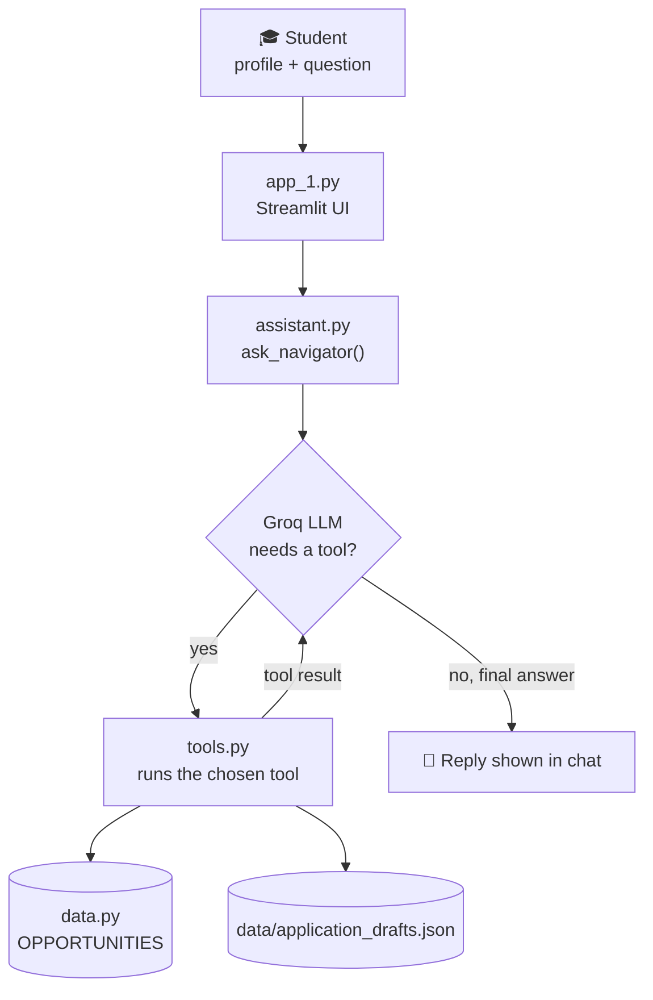

<div align="center">

# 🎓 Groq-Placement-Assistant

### An AI placement assistant that finds internships, checks eligibility, estimates stipends and saves application drafts, using real tools instead of guesswork.


</div>

---

## 📑 Table of Contents

- [✨ Features](#-features)
- [🧭 How It Works](#-how-it-works)
- [🧰 Tech Stack](#-tech-stack)
- [📂 Project Structure](#-project-structure)
- [🛠️ The Five Tools](#️-the-five-tools)
- [🚀 Getting Started (Step by Step)](#-getting-started-step-by-step)
- [🖥️ Using the App](#️-using-the-app)
- [💬 Example Conversations](#-example-conversations)
- [🛡️ Safety Design](#️-safety-design)
- [➕ Adding Your Own Opportunities](#-adding-your-own-opportunities)
- [🧯 Troubleshooting](#-troubleshooting)
- [⚠️ Limitations](#️-limitations)
- [🗺️ Ideas for Improvement](#️-ideas-for-improvement)
- [📄 License](#-license)

---

## ✨ Features

| | Feature | What it does |
|---|---|---|
| 🔎 | **Opportunity search** | Finds internships matching your skills and preferred location. |
| ✅ | **Eligibility check** | Compares your academic year and skills against an internship's requirements. |
| 💰 | **Stipend estimate** | Returns the listed monthly stipend range in ₹ (INR). |
| 📝 | **Draft saving** | Saves an application draft locally, clearly marked for human review. |
| 📚 | **Catalogue browser** | Lists every sample internship in an easy expandable view. |
| 🗂️ | **Draft viewer** | Shows all saved drafts in a table. |
| 🤖 | **Tool-calling LLM** | The model must use real tools, so it can't invent listings or stipends. |

---

## 🧭 How It Works



1. You fill in your **student profile** in the sidebar and ask a question.
2. The app bundles your profile and question into one message and sends it to the assistant.
3. The LLM decides whether to call a tool (search, eligibility, stipend, save or list drafts).
4. The tool runs in Python and returns a result.
5. The LLM explains the result in plain language. This loop runs for **at most 5 rounds** to avoid runaway calls.

---

## 🧰 Tech Stack

| Tool | Used for |
|---|---|
| **Python** | Application logic |
| **Streamlit** | Web interface with chat, tabs and sidebar |
| **LangChain** (`langchain`, `langchain-core`) | Tool definitions and message types |
| **langchain-groq** / **Groq** | Fast hosted LLM with tool calling |
| **JSON file** | Local storage for application drafts |

---

## 📂 Project Structure

```text
campus-opportunity-navigator/
├── app_1.py             # 🖥️ Streamlit interface (sidebar, chat, catalogue, drafts)
├── assistant.py         # 🤖 LLM setup, system prompt and tool-calling loop
├── tools.py             # 🛠️ The five tools + draft read/write helpers
├── data.py              # 📚 Sample internship catalogue (OPPORTUNITIES)
├── requirements_1.txt   # 📋 Dependencies
├── data/                # 📁 Created automatically on first draft/read
│   └── application_drafts.json
└── README.md
```

> 💡 If you prefer standard names, rename `app_1.py` to `app.py` and `requirements_1.txt` to `requirements.txt`. Then adjust the commands below.

---

## 🛠️ The Five Tools

| Tool | Inputs | Returns |
|---|---|---|
| `search_opportunities` | comma-separated skills, preferred location | Matching internship listings |
| `check_eligibility` | internship ID, student year, skills | Eligible yes/no, matched and missing skills, reason |
| `estimate_monthly_stipend` | internship ID | Min and max monthly stipend in INR |
| `save_application_draft` | name, email, internship ID, motivation | Confirmation that a draft was saved (not submitted) |
| `list_application_drafts` | none | All saved drafts |

### Eligibility rules (sample)

An internship is marked **eligible** when **both** are true:

- ✔️ Your academic year is **at least** the internship's minimum year
- ✔️ You match **at least one** of the required skills

### Search rules (sample)

- Skills match if **any** requested skill appears in an internship's skill list.
- A location filter keeps internships in that location, **plus all remote ones**.
- Choosing **Any** disables the location filter.

---

## 🚀 Getting Started (Step by Step)

### ✅ Prerequisites

- **Python 3.10 or newer**
- **pip**
- A free **Groq API key** from [console.groq.com](https://console.groq.com)

---

### Step 1 · Get the project

```bash
git clone <your-repository-url>
cd campus-opportunity-navigator
```

Or download the ZIP and extract it. Open a terminal in the folder that contains `app_1.py`.

---

### Step 2 · Create a virtual environment

**Windows (PowerShell)**

```powershell
py -m venv .venv
.venv\Scripts\Activate.ps1
```

**macOS / Linux**

```bash
python3 -m venv .venv
source .venv/bin/activate
```

✅ You should see `(.venv)` at the start of your prompt.

---

### Step 3 · Install dependencies

```bash
python -m pip install --upgrade pip
pip install -r requirements_1.txt
```

---

### Step 4 · Set your Groq API key 🔑

The app **refuses to start** unless the `GROQ_API_KEY` environment variable exists.

**Windows (PowerShell), current terminal only**

```powershell
$env:GROQ_API_KEY = "your_api_key_here"
```

**Windows, permanent** (then **restart your terminal**)

```powershell
setx GROQ_API_KEY "your_api_key_here"
```

**macOS / Linux**

```bash
export GROQ_API_KEY="your_api_key_here"
```

> 🔒 Never paste your key into the code or commit it to GitHub.

---

### Step 5 · (Optional) Choose a different model

The model name is read from the `GROQ_MODEL` environment variable. If it isn't set, the project uses the default written in `assistant.py`.

```powershell
# Windows PowerShell
$env:GROQ_MODEL = "your-model-name"
```

```bash
# macOS / Linux
export GROQ_MODEL="your-model-name"
```

Pick any Groq model that **supports tool calling**. Check the current model list in the Groq console.

---

### Step 6 · Launch the app 🚀

```bash
streamlit run app_1.py
```

Open the URL Streamlit prints (usually **http://localhost:8501**).

> If `streamlit` isn't found, use `python -m streamlit run app_1.py`.

---

## 🖥️ Using the App

### 1️⃣ Fill in your student profile (sidebar)

| Field | Purpose |
|---|---|
| Full name | Used when saving a draft |
| Email address | Used when saving a draft (must look like a valid email) |
| Current academic year | 1 to 4, used for eligibility |
| Skills | Comma separated, e.g. `python, sql, pandas` |
| Preferred location | Any, Kolkata or India |

### 2️⃣ Explore the three tabs

| Tab | What you'll find |
|---|---|
| 🤖 **AI Assistant** | Chat with the placement assistant |
| 📚 **Opportunity Catalogue** | Expandable cards for every listing |
| 📝 **Saved Drafts** | A table of drafts, with a refresh button |

---

## 💬 Example Conversations

| You ask | What happens behind the scenes |
|---|---|
| *"Find internships for Python and SQL."* | `search_opportunities` is called with your skills and location. |
| *"Check whether I qualify for INT102."* | `check_eligibility` compares your year and skills with INT102. |
| *"Estimate the stipend for INT103."* | `estimate_monthly_stipend` returns the ₹ range. |
| *"Save a draft for INT101."* | The assistant asks for any missing details, then calls `save_application_draft`. |
| *"Show my saved drafts."* | `list_application_drafts` returns everything stored locally. |

---

## 🛡️ Safety Design

- 🚫 **Never submits applications.** Drafts are labelled `DRAFT - HUMAN REVIEW REQUIRED`.
- 🧾 **No invented facts.** The system prompt forbids made-up opportunities, requirements or stipends.
- 🔧 **Tool-grounded answers.** Eligibility and stipend answers must come from tool results.
- ❓ **Asks before saving.** Missing details must be requested first.
- 📧 **Email check.** Drafts with an obviously invalid email are rejected.
- 🆔 **ID check.** Unknown internship IDs return a clear error.
- 🔁 **Bounded loop.** The assistant stops after 5 model/tool rounds.
- 🧱 **Error handling.** An unknown tool or a tool failure returns an error message instead of crashing.

---

## ➕ Adding Your Own Opportunities

Open `data.py` and add a new dictionary to the `OPPORTUNITIES` list:

```python
{
    "id": "INT105",
    "company": "Your Company",
    "role": "Your Role",
    "skills": ["python", "machine learning"],
    "min_year": 2,
    "duration_months": 3,
    "stipend_min": 10000,
    "stipend_max": 15000,
    "mode": "Remote",          # Remote, Hybrid or On-site
    "location": "India",
},
```

Keep skills in **lowercase**. The catalogue tab, search, eligibility and stipend tools will all pick up the new entry automatically.

---

## 🧯 Troubleshooting

| Problem | Fix |
|---|---|
| `RuntimeError: GROQ_API_KEY was not found` | Set the variable (Step 4) and **restart your terminal**. |
| `ModuleNotFoundError` | Activate the virtual environment and run `pip install -r requirements_1.txt`. |
| Model not found or tool-calling error | Set `GROQ_MODEL` to a current Groq model that supports tools. |
| Authentication error from Groq | Check that the key is correct and still active. |
| "Maximum tool steps reached" | Make your request more specific. |
| Saved Drafts tab is empty | Ask the assistant to save a draft, then click **Refresh saved drafts**. |
| Draft not saved | Provide a valid email and an existing internship ID (INT101 to INT104). |
| `streamlit` not recognised | Use `python -m streamlit run app_1.py`. |

---

## ⚠️ Limitations

- 📚 Listings are **sample data**, not live internships.
- 🧮 Eligibility rules are simplified: matching one skill is enough.
- 🗃️ Drafts are stored as **plain-text JSON**, so don't use this with sensitive personal data on a shared machine.
- 🌐 The assistant needs an internet connection and a valid Groq key.
- 🧠 Chat history is kept per browser session; the model only receives your latest message with your profile, not earlier turns.
- 📍 The `data/` folder is created relative to where you run the app, so launch it from the project folder.

---

## 🗺️ Ideas for Improvement

- [ ] Pass full chat history to the model for follow-up questions
- [ ] Rank search results by how many skills match
- [ ] Add a proper skill-match score for eligibility
- [ ] Draft cover letters from the student's profile
- [ ] Store drafts in SQLite with edit and delete options
- [ ] Load listings from a CSV or database
- [ ] Add automated tests for every tool
- [ ] Deploy on Streamlit Community Cloud (store the API key as a secret)

---

## 📄 License

No license is currently specified. Add a `LICENSE` file (for example MIT) before sharing or redistributing the project.

---

<div align="center">

**Built for students 🎓 · Powered by LangChain + Groq ⚡ · Humans always make the final call ✅**

⭐ If this project helped you, consider giving it a star!

</div>
